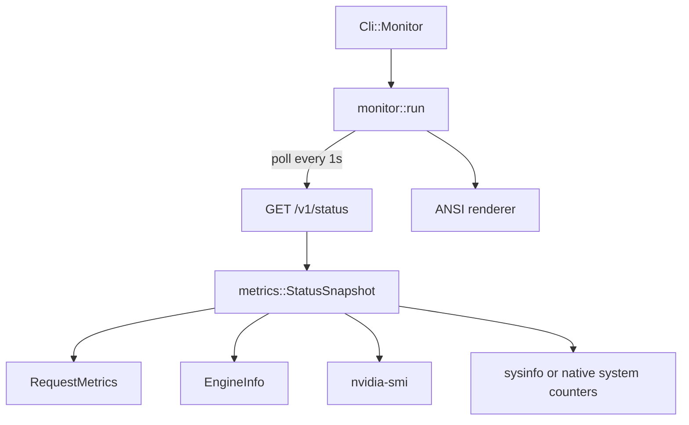

# Plan: терминальный монитор yforge

**Date:** 2026-10-28  
**Status:** 📝 Planning  
**Priority:** P1  
**Specification:** [docs/specs/2026-10-28-yforge-monitor.md](../specs/2026-10-28-yforge-monitor.md)

## Goal

Добавить `yforge monitor` в существующий бинарь и authenticated `/v1/status`, чтобы без второго сервиса видеть модель, скорость, VRAM, очередь и последние запросы.

## Current state

- `src/cli.rs` использует один `Parser` без подкоманд.
- `src/main.rs` сразу загружает Config и модель.
- `src/api.rs` собирает router и auth; `AppState` уже доступен всем handlers.
- `/v1/models` содержит model/runtime capabilities, но не counters.
- `src/engine_batched.rs` ведёт `in_flight` и `steps`; `CandleEngine` их наружу не публикует.
- `src/vram_plan.rs` умеет получать VRAM через `nvidia-smi`; CPU/RAM-сборщика нет.
- OpenAI/Responses/Anthropic handlers получают `GenerationUsage` в `StreamEvent::Done`, поэтому общий HTTP-level recorder может собирать usage без чтения prompts.

## Solution architecture



## Solution

### Server metrics

#### Files:
- [ ] `src/metrics.rs` — shared request counters, recent request buffer, uptime, GPU/system collectors.
- [ ] `src/api.rs` — add `Arc<RequestMetrics>` to `AppState`; route `/v1/status` under auth.
- [ ] `src/api/status.rs` — build JSON snapshot from metrics, engine info and collectors.
- [ ] `src/api/openai.rs` — create request guard and record completion/error usage.
- [ ] `src/api/responses.rs` — same request guard lifecycle.
- [ ] `src/api/anthropic.rs` — same request guard lifecycle.
- [ ] `src/main.rs` — initialize metrics before router; expose status endpoint.

#### Endpoint:

| Endpoint | Input | Output | Description |
|---|---|---|---|
| `GET /v1/status` | auth header | JSON status snapshot | Read-only runtime metrics |

#### Data structures:

```pseudo
RequestMetrics {
    started_at: Instant
    active: AtomicUsize
    completed: AtomicU64
    prompt_tokens: AtomicU64
    completion_tokens: AtomicU64
    recent: Mutex<VecDeque<RecentRequest>>
}

RecentRequest {
    started_at_unix_ms: u64
    endpoint: String
    prompt_tokens: u64
    completion_tokens: u64
    duration_ms: u64
    finish_reason: String
    error: Option<String>
}

StatusSnapshot {
    model: ModelInfo
    runtime: RuntimeCapabilities
    state: ready/loading/error
    totals: RequestTotals
    recent_requests: Vec<RecentRequest>
    gpu?: GpuStatus
    system?: SystemStatus
}
```

### Terminal client

#### Files:
- [ ] `src/cli.rs` — optional `monitor` subcommand with URL, api-key and refresh interval.
- [ ] `src/monitor.rs` — HTTP polling, rolling speed calculation and ANSI renderer.
- [ ] `src/main.rs` — dispatch monitor before Config/model load.
- [ ] `Cargo.toml` — add `crossterm` for raw keyboard input; add `sysinfo` for CPU/RAM on the server.

#### UI structure:

```pseudo
Monitor
  ├── Header(model, URL, connection, uptime)
  ├── Runtime(runtime backend, slots, context)
  ├── KPI cards(speed, GPU, VRAM, temp/power, CPU/RAM)
  ├── Active/queue
  ├── Recent requests table
  └── Footer(q detach, r refresh, Ctrl+C quit)
```

### Phase 1: Metrics foundation (estimate: 5 h)
- [ ] Add `RequestMetrics` and a RAII `RequestGuard`.
- [ ] Wire guard into all three generation APIs; record only usage and metadata.
- [ ] Add `/v1/status` with model/runtime/counters but optional GPU/system fields.
- [ ] Unit-test ring buffer, rolling speed and redaction behavior.
- **Independent check:** `cargo test --features cuda-turing status_metrics` locally; query `/v1/status` with valid/invalid key on yttri-win.

### Phase 2: System collectors (estimate: 4 h)
- [ ] Add bounded `nvidia-smi` GPU collector with timeout and cache.
- [ ] Add sysinfo CPU/RAM collector.
- [ ] Degrade missing metrics to `null`, not errors.
- **Independent check:** status returns GPU/system values on yttri-win; with `PATH` lacking nvidia-smi it still returns HTTP 200.

### Phase 3: Terminal overview (estimate: 7 h)
- [ ] Add `monitor` subcommand and URL/API-key validation.
- [ ] Build ANSI renderer for wide and narrow terminals.
- [ ] Implement one-second polling, rolling tok/s and reconnect status.
- [ ] Implement `q`, `r`, Ctrl+C and terminal cleanup.
- **Independent check:** run monitor against test server, submit a 200-token request in another terminal, verify live output speed and request history update.

### Phase 4: Compatibility and polish (estimate: 4 h)
- [ ] Windows and Linux terminal smoke tests on yttri-win.
- [ ] `NO_COLOR=1`, redirect/non-TTY behavior and Unicode fallback.
- [ ] Document command, auth and read-only boundary in README.
- **Independent check:** clean `cargo test`, `cargo check --features cuda-turing`, and manual monitor run without leaving server stopped.

## Traceability: Requirements → Tasks

| Requirement | Phase | Tasks |
|-------------|-------|-------|
| FR-001 | 3 | Subcommand in existing yforge |
| FR-002 | 3 | URL/API-key parsing, no secret output |
| FR-003 | 1 | RequestMetrics and `/v1/status` |
| FR-004 | 1, 3 | Polling and runtime backend |
| FR-005 | 2, 3, 4 | Optional metrics and terminal degradation |
| FR-006 | 3 | Read-only detach behavior |
| FR-010 | 1, 3 | Rolling speed |
| FR-011 | 1, 3 | Recent request table |
| FR-012 | 2 | GPU collector |
| FR-013 | 2, 4 | sysinfo CPU/RAM |

## Complexity & principle deviations

| Deviation | Principle / simpler alternative | Why justified |
|-----------|--------------------------------|---------------|
| New `crossterm` + `sysinfo` | Handle terminal and system stats with std only | Cross-platform raw mode and CPU/RAM accounting are not reliably available in std; both are established dependencies |
| Metrics in every API handler | Only display logs | Logs miss completed timing/usage and cannot be safely consumed remotely |
| Separate `/v1/status` | Extend `/v1/models` | Model discovery and live telemetry have different polling and stability semantics |

## Risks and mitigations

| Risk | Likelihood | Impact | Mitigation |
|------|------------|--------|------------|
| Request guard dropped before SSE completes | Medium | High | Guard owned by SSE mapping closure; integration tests for streaming and disconnect |
| GPU query blocks async runtime | Medium | Medium | Run collector in blocking task with timeout/cache |
| Metrics leak private content | Low | High | Store metadata only, never prompt/completion text |
| TUI leaves terminal in raw mode on panic/exit | Medium | Medium | Drop guard restores terminal; panic hook cleanup |
| Windows console lacks ANSI | Medium | Medium | Enable virtual terminal or fallback renderer |

## Dependencies

### Packages / Libraries
- `crossterm` for terminal mode/keys.
- `sysinfo` for CPU/RAM.

### Related tasks
- Depends on runtime capability fields from Turing plan; endpoint imports the same fields.

## Deferred questions

| Question | Why deferred | When the answer is needed | Who decides |
|----------|--------------|---------------------------|-------------|
| Log viewer inside monitor | Requires local log path and service/foreground distinction | After P0 | Product owner |
| Multi-tab layout | Overview is sufficient for first version | Before P2 | UX owner |

## Plan decisions

| # | Question | Decision | Date |
|---|----------|----------|------|
| PD-001 | Подкоманда или отдельный binary? | `yforge monitor` in same binary. | 2026-10-28 |
| PD-002 | Как собирать usage? | HTTP-level RAII guard around the existing stream lifecycle. | 2026-10-28 |
| PD-003 | Где собирать системные метрики? | Server-side in `/v1/status`, bounded and cached. | 2026-10-28 |
| PD-004 | Как рисовать без сложного UI framework? | Crossterm + custom ANSI renderer. | 2026-10-28 |

## Tech Debt

| # | Description | Phase | Priority |
|---|-------------|-------|----------|
| TD-001 | No full log viewer in v1 | 3 | Medium |
