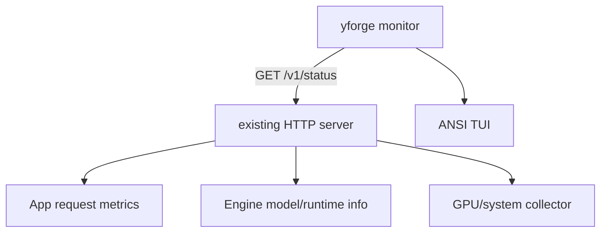

# Specification: терминальный монитор yforge

**Date:** 2026-10-28
**Priority:** P1
**Type:** New feature

## 1. Problem

Чтобы понять состояние сервера, сейчас нужно открыть WebUI, отдельный монитор или читать длинный лог. Пользователю нужен компактный экран в том же бинаре `yforge`, показывающий модель, скорость, VRAM, очередь и последние запросы без запуска дополнительного сервиса.

## 2. Goal

Добавить команду `yforge monitor`, которая подключается к работающему серверу по HTTP, раз в секунду обновляет read-only overview и завершается по `q` без остановки сервера. Данные о сервере и GPU собираются самим `yforge`; отдельный процесс, database или UI server не создаются.

## 3. Current state

- `src/main.rs` всегда запускает inference-сервер и загружает модель.
- `src/cli.rs` описывает только флаги сервера; подкоманд нет.
- `src/api.rs` содержит router, auth middleware и общий `AppState`.
- `/v1/models` отдаёт модель, context, quant, slots и capabilities, но не runtime metrics.
- `src/vram_plan.rs` уже вызывает `nvidia-smi` для total/free VRAM.
- `reqwest`, `tokio`, `serde_json`, `windows-sys` уже являются зависимостями.
- В engine есть `in_flight` и счётчик шагов для `BatchedEngine`, но наружу они не опубликованы и не охватывают `CandleEngine`.

## 4. User scenarios

### Scenario 1: Overview работающего сервера (P0)

**As** оператор, **I want** открыть `yforge monitor`, **so that** за один экран увидеть, что сервер жив и что происходит с инференсом.

**Steps:**
1. Пользователь запускает `yforge monitor --url http://127.0.0.1:18099 --api-key KEY`.
2. Команда опрашивает `/v1/status`.
3. Терминал рисует overview и обновляет его раз в секунду.
4. `q` отключает монитор, сервер продолжает работать.

**Acceptance criteria (Given / When / Then):**
- [x] Given работающий сервер, when открыт monitor, then видны model id, ready/loading/error, slots, context used/limit, prompt/completion tokens и rolling output tok/s.
- [x] Given CUDA, when доступен `nvidia-smi`, then видны GPU util, VRAM used/total, temperature и power.
- [x] Given нет части системных метрик, when открыт monitor, then экран продолжает работать и показывает `n/a` только для отсутствующих полей.
- [ ] Given нажата `q` или Ctrl+C, when monitor завершается, then inference-сервер не останавливается.

### Scenario 2: Последние запросы (P1)

**As** оператор, **I want** видеть последние завершённые запросы, **so that** понимать, кто создаёт нагрузку и какие запросы медленные.

**Acceptance criteria:**
- [x] Given минимум пять завершённых запросов, when открыт monitor, then видно время, endpoint, prompt/completion tokens, tok/s, duration и finish reason.
- [x] Given активный запрос, when обновляется overview, then его состояние отображается в очереди/active без ожидания завершения.
- [x] Given failed request, when он попадает в историю, then ошибка отображается как error без текста секретов или тела запроса.

## 5. Functional requirements

### Must Have (P0)

- **FR-001:** Monitor запускается как подкоманда того же `yforge`; отдельный бинарник и service не создаются.
- **FR-002:** Monitor принимает URL и API key через аргументы/env, не печатает ключ и не сохраняет его.
- **FR-003:** Сервер публикует authenticated `/v1/status` с model info, uptime, active/completed counters, token counters и последними запросами.
- **FR-004:** Overview обновляется не реже одного раза в две секунды и показывает выбранный attention/runtime backend.
- **FR-005:** Экран работает при узком терминале, без Unicode/цвета и с `NO_COLOR=1`; отсутствие метрики не считается фатальной ошибкой.
- **FR-006:** `q`, Ctrl+C и потеря соединения не останавливают inference-сервер.

### Should Have (P1)

- **FR-010:** Rolling output tok/s вычисляется по приросту completion tokens за последние 5 секунд.
- **FR-011:** Последние пять запросов показывают endpoint, usage, duration и finish reason.
- **FR-012:** GPU metrics включают util, VRAM, temp и power, когда их отдаёт `nvidia-smi`.
- **FR-013:** CPU/RAM показываются кросс-платформенно; недоступные поля скрываются.

### Nice to Have (P2)

- **FR-020:** Клавиша `r` принудительно обновляет экран.
- **FR-021:** Клавиша `l` открывает последние строки серверного лога, если монитор запущен на той же машине.
- **FR-022:** Несколько вкладок Overview/Serving/Requests/GPU.

## 6. Non-functional requirements

- **Performance:** Один опрос в секунду; сбор системных метрик не дольше 250 мс и не блокирует inference.
- **Security:** `/v1/status` использует существующую auth middleware; monitor не логирует API key, prompt и completion text.
- **Compatibility:** Windows 10/11, Linux и macOS. Nvidia-only fields optional.
- **Reliability:** Кратковременная ошибка HTTP показывается в status bar; следующие опросы продолжаются.
- **Accessibility:** Высокий контраст и отсутствие зависимости от цвета для смысла.

## 7. Data model

```text
RuntimeStatus
  - model: id, quant, context_length, slots
  - state: ready/loading/error, uptime_s
  - runtime: backend, attention, prefill, paged_prefill, cuda_graphs
  - totals: active_requests, completed_requests, prompt_tokens, completion_tokens
  - recent_requests[0..5]: started_at, endpoint, prompt_tokens, completion_tokens,
                             duration_ms, tokens_per_sec, finish_reason, error
  - gpu: name, util_percent, vram_used_mib, vram_total_mib, temp_c, power_w, power_limit_w
  - system: cpu_percent, ram_used_mib, ram_total_mib
```

## 8. User interface

```text
YFORGE  http://127.0.0.1:18099    model qwen3.8-27b    ● ready    [LIVE]
Runtime  cuda-turing · split_k_f16_f32_softmax · 1 slot · 00:42:18
Model    █████████░░ 28K / 32K  · active 2 · queue 0
Speed    24.8 tok/s     GPU 96%     VRAM 10.4 / 12.0 GiB    65°C
Recent requests
TIME      ENDPOINT              PROMPT   OUTPUT   TOK/S   DURATION   STATE
14:33:51  chat.completions      2,711      256    24.8     10.3s     stop
...
q detach · r refresh · Ctrl+C quit
```

Ширина ниже 80 колонок переводит карточки в один столбец. Цвет не обязателен для понимания состояния.

## 9. Architecture (overview)



## 10. Out of scope

- Управление моделью, изменение настроек и отправка запросов из monitor.
- Отдельный daemon, WebSocket stream или database.
- Чтение prompts/completions и их сохранение.
- Полноценный log viewer в P0.

## 11. Deferred questions

| Question | Why deferred | When the answer is needed | Who decides |
|----------|--------------|---------------------------|-------------|
| Нужен ли log-viewer внутри monitor | Требует доступа к локальному файлу лога и различается для service/foreground | После overview P0 | Product owner |
| Нужны ли несколько вкладок | Overview закрывает основной сценарий | Перед P2 | UX owner |

## 12. Spec decisions

| # | Question | Decision | Date |
|---|----------|----------|------|
| D-001 | Отдельный монитор или тот же `yforge`? | Тот же бинарь, подкоманда `monitor`. | 2026-10-28 |
| D-002 | Монитор читает логи или API? | API; prompts/completions не передаются. | 2026-10-28 |
| D-003 | Что делать при недоступной метрике? | Показать `n/a`, не прерывать UI. | 2026-10-28 |
| D-004 | Где собирать GPU metrics? | На сервере в `/v1/status`, с коротким timeout. | 2026-10-28 |

## 13. Success criteria

- [ ] `yforge monitor` показывает живой overview на Windows и Linux.
- [ ] `q` отключает только монитор.
- [x] `/v1/status` не раскрывает prompts/completions и требует API key.
- [x] Экран остаётся работоспособным при отсутствии `nvidia-smi` или части системных данных.
